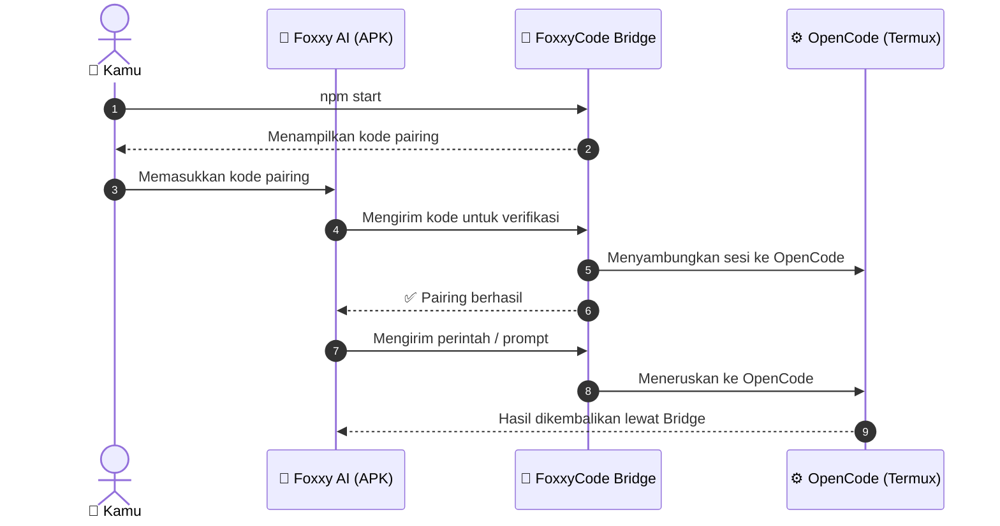

<div align="center">



<br/>

<a href="https://github.com/foxxyoffc/FoxxyCode-Bridge/stargazers"></a>


<br/><br/>

**Hubungkan aplikasi Foxxy AI ke OpenCode di Termux hanya dengan satu kode pairing.**

[✨ Tentang](#-tentang-project) &nbsp;•&nbsp;
[🔁 Cara Kerja](#-cara-kerja) &nbsp;•&nbsp;
[🚀 Langkah Pairing](#-langkah-pairing) &nbsp;•&nbsp;
[🧰 Troubleshooting](#-troubleshooting) &nbsp;•&nbsp;
[🦊 Developer](#-developer)

</div>


## ✨ Tentang Project

**FoxxyCode Bridge** adalah jembatan penghubung antara aplikasi **Foxxy AI** (APK) dan **OpenCode** yang berjalan di **Termux**.

Dengan Bridge ini, kamu tidak perlu repot mengatur koneksi secara manual. Cukup jalankan Bridge di Termux, lalu masukkan **kode pairing** yang muncul ke aplikasi Foxxy AI, dan kedua sisi langsung terhubung.

<table align="center">
  <tr>
    <td align="center" width="25%">
      <h3>⚡</h3>
      <b>Pairing Cepat</b><br/>
      <sub>Cukup satu kode, tanpa konfigurasi rumit</sub>
    </td>
    <td align="center" width="25%">
      <h3>📱</h3>
      <b>Langsung di HP</b><br/>
      <sub>Berjalan penuh di Termux, tanpa perlu PC</sub>
    </td>
    <td align="center" width="25%">
      <h3>🪶</h3>
      <b>Ringan</b><br/>
      <sub>Dibangun dengan Node.js, instalasi cukup <code>npm install</code></sub>
    </td>
    <td align="center" width="25%">
      <h3>🔗</h3>
      <b>Terhubung ke OpenCode</b><br/>
      <sub>Foxxy AI dan OpenCode saling terkoneksi lewat Bridge</sub>
    </td>
  </tr>
</table>


## 🔁 Cara Kerja



<div align="center">

| Tahap | Apa yang terjadi |
| :---: | :--- |
| **1. Jalankan** | Bridge aktif di Termux dan menghasilkan kode pairing |
| **2. Pairing** | Kode dimasukkan ke aplikasi Foxxy AI untuk verifikasi |
| **3. Terhubung** | Foxxy AI dan OpenCode tersambung lewat Bridge |

</div>


## 📋 Prasyarat

- 📱 Android dengan **[Termux](https://termux.dev)** terpasang
- ⚙️ **OpenCode** sudah terpasang dan berjalan di Termux
- 🟢 **Node.js** dan **Git** di Termux
- 🦊 Aplikasi **Foxxy AI** (APK) terpasang di perangkat

Belum punya Node.js dan Git? Pasang dengan:

```bash
pkg update && pkg upgrade -y
pkg install nodejs git -y
```


## 🚀 Langkah Pairing

<div align="center">
  
</div>

<br/>

### 1️⃣ &nbsp;Download repository di Termux

```bash
git clone https://github.com/foxxyoffc/FoxxyCode-Bridge.git
cd FoxxyCode-Bridge
```

### 2️⃣ &nbsp;Install dependencies

```bash
npm install
```

### 3️⃣ &nbsp;Jalankan Bridge

```bash
npm start
```

Setelah Bridge aktif, **kode pairing** akan muncul di layar Termux.

### 4️⃣ &nbsp;Masukkan kode ke aplikasi Foxxy AI

Buka aplikasi **Foxxy AI**, lalu masukkan kode pairing yang kamu terima dari Termux. Setelah kode diterima, Foxxy AI dan OpenCode sudah terhubung. 🎉

> [!TIP]
> OpenCode dan Bridge sama-sama berjalan di Termux, jadi buka **session baru** (geser dari tepi kiri layar, lalu **New session**) agar keduanya bisa aktif bersamaan.


## 🧰 Troubleshooting

<details>
<summary><b>❓ <code>npm: command not found</code></b></summary>

<br/>

Node.js belum terpasang. Jalankan:

```bash
pkg install nodejs -y
```

</details>

<details>
<summary><b>❓ <code>git: command not found</code></b></summary>

<br/>

Git belum terpasang. Jalankan:

```bash
pkg install git -y
```

</details>

<details>
<summary><b>❓ Kode pairing tidak diterima di Foxxy AI</b></summary>

<br/>

- Pastikan OpenCode sudah berjalan di Termux
- Hentikan Bridge dengan `Ctrl + C`, jalankan lagi `npm start`, lalu gunakan kode terbaru yang muncul
- Periksa kembali kode yang diketik, jangan sampai ada karakter yang salah

</details>

<details>
<summary><b>❓ Ingin memperbarui ke versi terbaru</b></summary>

<br/>

```bash
cd FoxxyCode-Bridge
git pull
npm install
npm start
```

</details>


## 🦊 Developer

<div align="center">

<a href="https://github.com/foxxyoffc">
  
</a>

<br/><br/>

Project Created By **FoxxyOffc**

Kalau project ini bermanfaat, jangan lupa kasih ⭐ di repository ini, ya!

<br/>


<sub>©2026 FoxxyOffc · FoxxyPlay All Right Reserved</sub>

</div>
