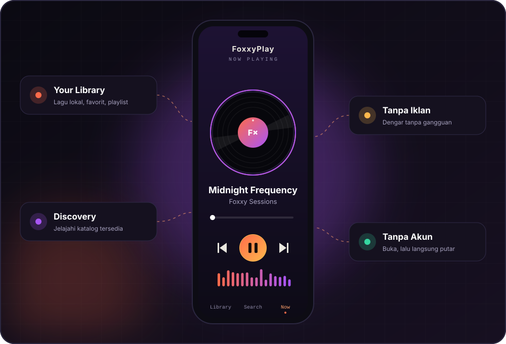
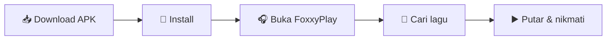
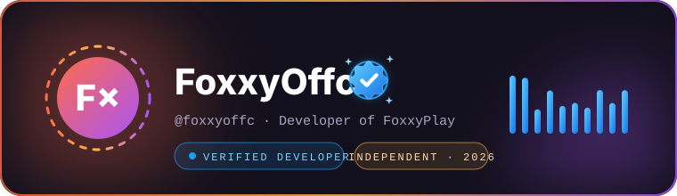

 

  

  

**Streaming musik gratis, tanpa iklan, tanpa buat akun. Buka, lalu putar.**

[✨ Tentang](#-tentang-foxxyplay) &nbsp;•&nbsp;
[📱 Tampilan](#-tampilan) &nbsp;•&nbsp;
[🎯 Kegunaan](#-kegunaan) &nbsp;•&nbsp;
[💎 Fitur](#-fitur) &nbsp;•&nbsp;
[📥 Cara Pakai](#-cara-pakai) &nbsp;•&nbsp;
[❓ FAQ](#-faq) &nbsp;•&nbsp;
[🦊 Developer](#-developer)

## ✨ Tentang FoxxyPlay

**FoxxyPlay** adalah aplikasi Android pemutar dan streaming musik yang dibuat dengan satu prinsip: **musik harus terasa milikmu**, tanpa gangguan.

Tidak ada iklan yang memotong lagu, tidak ada form pendaftaran, dan tidak ada langganan. Install aplikasinya, buka, cari lagu, lalu putar. Koleksi lagu di perangkat, lagu favorit, dan musik baru yang ingin kamu temukan semuanya ada dalam satu tempat.

> *"Find your frequency."*

<table align="center">
  <tr>
    <td align="center" width="25%">
      <h3>🎧</h3>
      <b>100% Gratis</b> 
      Tanpa biaya langganan
    </td>
    <td align="center" width="25%">
      <h3>🚫</h3>
      <b>Tanpa Iklan</b> 
      Dengarkan tanpa terputus
    </td>
    <td align="center" width="25%">
      <h3>🔓</h3>
      <b>Tanpa Akun</b> 
      Tidak perlu daftar atau login
    </td>
    <td align="center" width="25%">
      <h3>🤖</h3>
      <b>Dibuat untuk Android</b> 
      Ringan dan fokus ke pengalaman mendengar
    </td>
  </tr>
</table>

## 📱 Tampilan

  
   
  Ilustrasi tampilan pemutar FoxxyPlay

## 🎯 Kegunaan

| Kebutuhan | Bagaimana FoxxyPlay membantu |
| :--- | :--- |
| 🎵 **Dengar musik setiap hari** | Putar lagu favorit tanpa iklan yang mengganggu |
| 📂 **Kelola koleksi lagu** | Telusuri lagu lokal di perangkat, simpan favorit, dan susun playlist sesuai mood |
| 🔎 **Cari lagu baru** | Jelajahi musik dari katalog yang didukung lewat pencarian |
| ⚡ **Mau langsung pakai** | Tanpa registrasi, tanpa login, cukup install lalu putar |
| 🚶 **Dengar sambil beraktivitas** | Audio tetap berjalan di latar belakang untuk lagu yang didukung |

## 💎 Fitur

<table>
  <tr>
    <td width="50%" valign="top">
      <h3>📚 Library</h3>
      Telusuri lagu lokal, simpan yang kamu suka, dan buat playlist untuk setiap suasana hati.
    </td>
    <td width="50%" valign="top">
      <h3>🔍 Pencarian & Discovery</h3>
      Cari dan temukan musik dari provider yang didukung untuk menemukan lagu berikutnya.
    </td>
  </tr>
  <tr>
    <td width="50%" valign="top">
      <h3>▶️ Kontrol Pemutaran</h3>
      Play, pause, next, previous, dan antrean lagu untuk pengalaman mendengar yang fokus.
    </td>
    <td width="50%" valign="top">
      <h3>🎚️ Audio Latar Belakang</h3>
      Musik tetap menyala saat kamu membuka aplikasi lain atau mengunci layar.
    </td>
  </tr>
  <tr>
    <td width="50%" valign="top">
      <h3>🚫 Tanpa Iklan</h3>
      Tidak ada iklan yang memotong lagu atau mengganggu suasana.
    </td>
    <td width="50%" valign="top">
      <h3>🔓 Tanpa Akun</h3>
      Tidak perlu daftar, login, atau memberikan email. Langsung pakai.
    </td>
  </tr>
</table>

> [!NOTE]
> Katalog dan ketersediaan pemutaran dapat berbeda tergantung provider yang didukung.

## 📥 Cara Pakai

### 1️⃣ &nbsp;Download aplikasi

Buka halaman resmi FoxxyPlay lalu unduh file APK:

  

### 2️⃣ &nbsp;Install APK

1. Buka file APK yang sudah diunduh.
2. Jika diminta, aktifkan izin **Install dari sumber tidak dikenal** untuk browser atau file manager yang kamu pakai.
3. Ketuk **Install** dan tunggu sampai selesai.

### 3️⃣ &nbsp;Buka dan langsung pakai

Buka **FoxxyPlay**. Tidak ada pendaftaran atau login, kamu bisa langsung masuk ke aplikasi.

### 4️⃣ &nbsp;Cari, putar, dan simpan

- Gunakan **pencarian** untuk menemukan lagu yang kamu mau.
- Ketuk lagu untuk memutarnya.
- Simpan lagu ke **favorit** atau susun ke **playlist** agar mudah ditemukan lagi.

> [!TIP]
> Unduh hanya dari link resmi di halaman ini supaya aplikasi yang kamu pasang aman dan terbaru.

## ❓ FAQ

<b>Apakah FoxxyPlay benar-benar gratis?</b>

 

Ya, FoxxyPlay gratis dipakai, tanpa langganan.

<b>Apakah ada iklan?</b>

 

Tidak. FoxxyPlay dibuat tanpa iklan supaya kamu bisa mendengar tanpa gangguan.

<b>Apakah harus buat akun?</b>

 

Tidak perlu. Cukup install, buka, lalu putar.

<b>Ada lagu yang tidak bisa diputar, kenapa?</b>

 

Ketersediaan lagu bergantung pada katalog provider yang didukung, jadi bisa berbeda-beda. Coba cari versi lain dari lagu tersebut atau coba lagi beberapa saat kemudian.

<b>Muncul peringatan saat install APK?</b>

 

Itu normal untuk aplikasi yang dipasang di luar Play Store. Aktifkan izin **Install dari sumber tidak dikenal** untuk aplikasi yang kamu gunakan membuka APK, dan pastikan file diunduh dari link resmi.

## 🦊 Developer

 

Developer di balik FoxxyPlay, proyek pemutar musik Android independen.

Kalo suka FoxxyPlay, minimal kasih ⭐ lahh🗿 

FoxxyPlay By <b>FoxxyOffc</b> · © 2026 All Right Reserved

