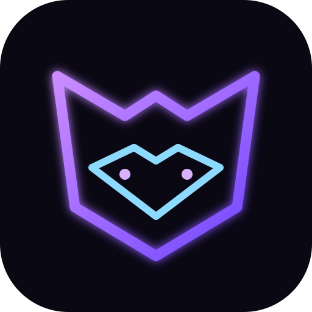
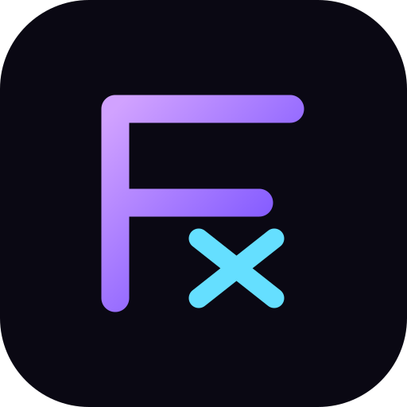

<div align="center">



# FOXXYPLAY

### NEON AUDIO INTELLIGENCE


**A modern Android music experience.**

**Developer: Foxxy Offc** 

<br/>


<br/><br/>

[ FEATURES ](#-features) •
[ INSTALLATION ](#-installation) •
[ BUILD ](#-build) •
[ BRANDING ](#-branding)

</div>

---

## ◈ About FoxxyPlay

FoxxyPlay is a native Android music application developed by **FoxxyOffc**, built with Kotlin and Jetpack Compose.

Designed around a modern interface, music playback experience, and a dedicated developer edition.

## ◈ Features

- Modern native Android interface
- Music playback experience
- Library and playlist management
- Search and music discovery
- Favorites and playback queue
- Now Playing interface
- Public and Developer editions
- Developer API integration
- Maintenance and application management

*Feature availability depends on the configured services and application edition.*

## ◈ Editions

| Edition | Application ID | Description |
|---|---|---|
| Public | `com.foxxy.play` | Main FoxxyPlay application |
| Developer | `com.foxxy.play.developer` | Developer management edition |

## ◈ Technology

| Technology | Usage |
|---|---|
| Kotlin | Main programming language |
| Jetpack Compose | UI toolkit |
| Android SDK | Native Android platform |
| Gradle Kotlin DSL | Build configuration |
| OkHttp | HTTP networking |
| Firebase | Public edition service integration |

## ◈ Branding

Five visual directions for the FoxxyPlay identity.

<div align="center">

| Neon Fox | Cyber Orbit |
|:---:|:---:|
|  |  |
| Audio Wave | Foxxy Monogram |
|  |  |

**Holographic Disc**


</div>

All branding assets are available in `assets/branding/`.

## ◈ Installation

### Requirements

- Android Studio
- JDK 21
- Android SDK 36
- Android SDK Platform 26 or newer for the app

### Clone repository

```bash
git clone YOUR_REPOSITORY_URL
cd FoxxyPlay
```

### Configure local properties

```bash
cp local.properties.example local.properties
```

Edit `local.properties`:

```properties
sdk.dir=/your/android/sdk/path
musicapi.clientId=YOUR_MUSIC_CLIENT_ID
```

### Firebase configuration

For the Public edition, add your own Firebase configuration:

```text
app/src/public/google-services.json
```

Never commit private credentials or local configuration files.

## ◈ Build

### Public edition

```bash
./gradlew assemblePublicDebug
```

### Developer edition

```bash
./gradlew assembleDeveloperDebug
```

### Build both editions

```bash
./gradlew assemblePublicDebug assembleDeveloperDebug
```

APK output:

```text
app/build/outputs/apk/
├── public/debug/
└── developer/debug/
```

The Developer edition skips the Google Services processing task. The Public edition needs its own Firebase configuration for Firebase integration.

## ◈ Project Structure

```text
FoxxyPlay/
├── app/
│   └── src/
│       ├── main/
│       ├── public/
│       └── developer/
├── assets/
│   └── branding/
├── backup-v1.0.5/
├── gradle/
├── scripts/
├── build.gradle.kts
├── settings.gradle.kts
├── gradle.properties
├── local.properties.example
└── README.md
```

## ◈ Security

- Local configuration is excluded from Git.
- Firebase configuration is excluded from Git.
- Signing credentials must never be committed.
- Use your own service credentials when building.
- Never put server-side private keys inside an Android APK.

## ◈ Developer

<div align="center">


**FOXXYOFFC**

*Designing. Developing. Creating.*

</div>

---

<div align="center">

### FOXXYPLAY — MADE WITH PASSION.

**FoxxyOffc © 2026. All Rights Reserved.**

<sub>Built for music lovers. Powered by creativity.</sub>

</div>
